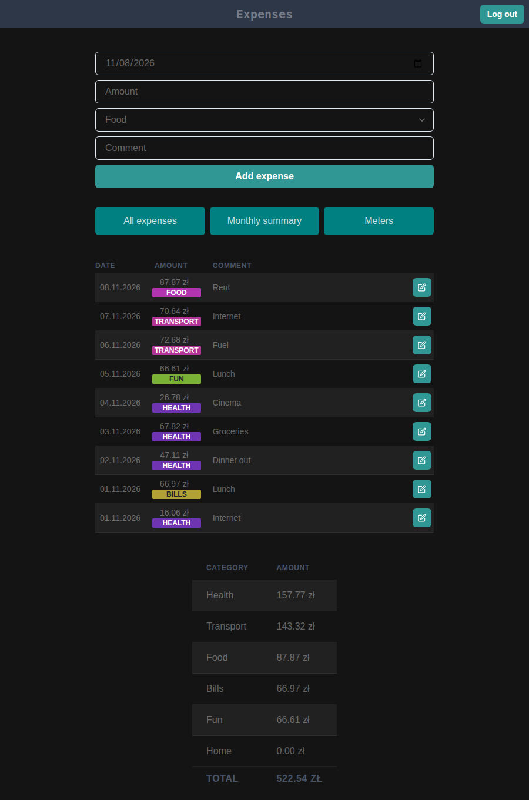
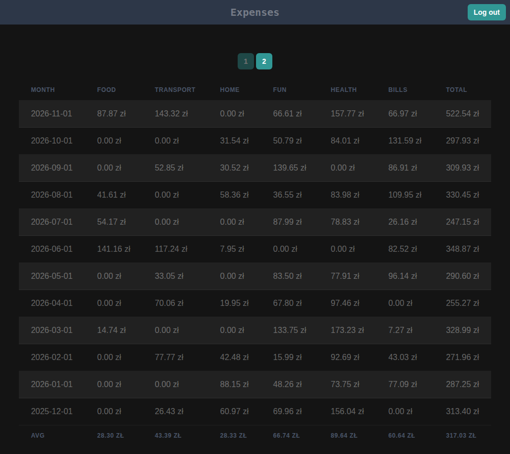

# Expenses

A small, self-hosted app for tracking personal expenses and utility meter readings.

| Home | Monthly summary |
| --- | --- |
|  |  |

## Features

- Add, edit and delete expenses with category, comment and date
- Current-month overview with per-category totals
- Monthly summary by category, with averages
- Meter readings (electricity, water, gas…) with units
- JWT login; every user sees only their own data
- Responsive UI

## Structure

| Dir | What | Stack |
| --- | --- | --- |
| [`backend/`](backend/Readme.md) | REST API + admin | Django, DRF, SimpleJWT, PostgreSQL |
| [`frontend/`](frontend/README.md) | Web client | React, TypeScript, Vite, Chakra UI, TanStack Query |

## Quick start

```bash
# API  (needs SECRET_KEY and DATABASE_URL, see backend/Readme.md)
cd backend && uv sync && uv run python manage.py migrate && uv run python manage.py runserver 5002

# UI
cd frontend && npm ci && VITE_API_URL=http://localhost:5002/ npm start
```

Users are created in the Django admin (`/admin/`); there is no public sign-up.

## Deployment

Each part has a `prod.Dockerfile`. GitHub Actions lint, build and push the images on every push to `master`
(changes under `frontend/` only deploy the frontend, everything else deploys the backend).
