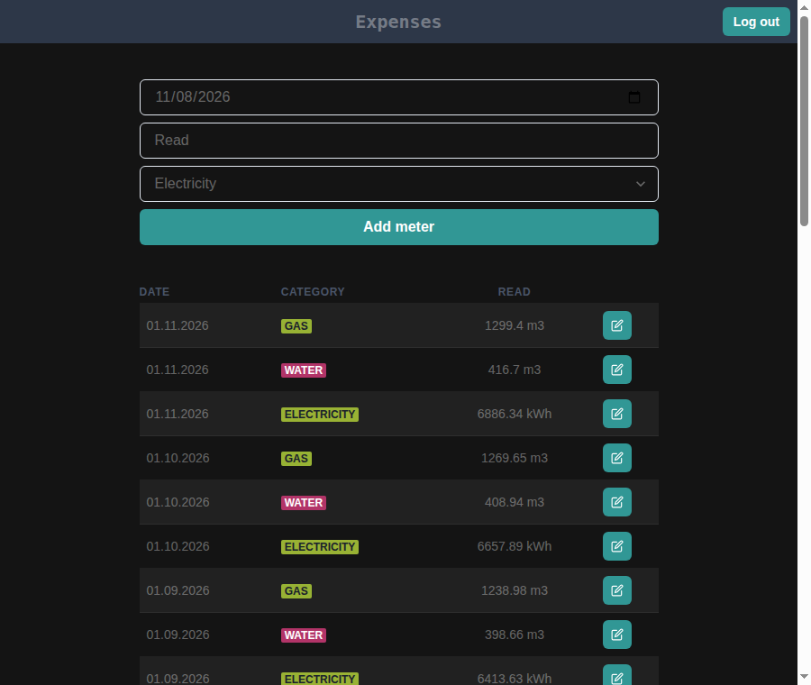
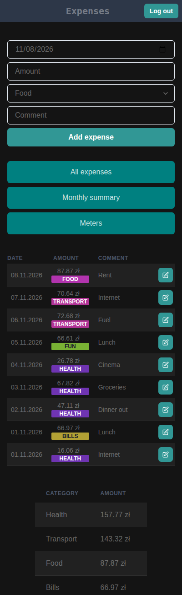

# Expenses – frontend

React client for the [expenses app](../README.md).

| Meters | Mobile |
| --- | --- |
|  |  |

## Stack

React 19 · TypeScript · Vite · Chakra UI · TanStack Query · Redux Toolkit (persisted session) · react-hook-form · [Biome](https://biomejs.dev/)

## Run locally

```bash
npm ci
VITE_API_URL=http://localhost:5002/ npm start   # http://localhost:5173
```

`VITE_API_URL` is the backend base URL (defaults to `https://eb.rivit.dev/`).

## Scripts

| Command | Does |
| --- | --- |
| `npm start` | dev server |
| `npm run build` | production build to `build/` |
| `npm run preview` | serve the production build |
| `npm run check` / `check:fix` | Biome lint + format check / autofix |

## Structure

```
src/
  app/        routing, query client
  features/   auth, home, expenses, meters, nav
  hooks/      react-query queries & mutations
  services/   API calls
  store/      redux + persisted user session
```

## Production

[`prod.Dockerfile`](./prod.Dockerfile) builds the app and serves it with nginx ([`nginx.conf`](./nginx.conf)).
`VITE_API_URL` is baked in at build time; the Dockerfile doesn't set it, so the default API URL is used unless you add an `ARG`/`ENV`.
